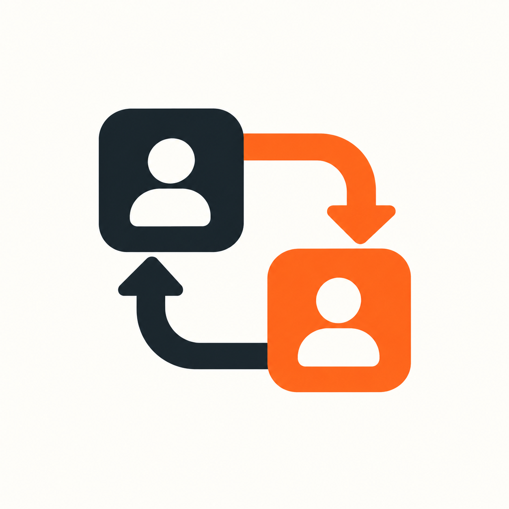

# Local Model Delegation



**Let your agent set up local delegation with you, one step at a time.**

Local models handle tasks they have demonstrated they can do. Your native agent checks their work and provides fallback.

## Start with one prompt

Open **Codex on your Mac** with access to local files and a terminal, then paste:

```text
Read https://raw.githubusercontent.com/fcoouto/local-model-delegation/main/docs/onboarding.md and guide me through setup on this computer, reusing what is already configured, asking one question at a time when needed, and verifying each completed step.
```

Your agent checks the environment, handles the available setup steps, and asks for your input when it reaches a decision. If a step needs a click in another app, it gives you that single action and continues when you return. You do not need to prepare configuration files yourself.

**Already started? Use the same prompt to resume.** The agent reuses your installation, settings and shared state instead of starting over.

The link reads the version published on `main`. To try an unpublished checkout, ask your agent to read its local `docs/onboarding.md` instead. A chat without local computer access can explain setup but cannot perform or verify it.

**Development preview. Routing stays disabled by default.** Installation, permission for model assessments, approval of an exact model and provisional task scope, and activation are separate decisions. You can pause and resume later.

## Update your plugin

Already installed? Open Codex with local computer access and paste:

```text
Read https://raw.githubusercontent.com/fcoouto/local-model-delegation/main/docs/updating.md and guide me through updating Local Model Delegation to the latest published numbered release. Preserve my settings, approvals and history, and verify the installed version and saved state.
```

The agent checks your installed version, stages the release, backs up private state, updates through Codex's native plugin installer, and verifies the result. It pauses for active or uncertain tasks. After successful verification, it restores your saved routing and agent representation publishing state. Disabled controls stay disabled; updating never grants model approval or first-time activation. A merged PR does not update installed plugins; a numbered release must be published first.

Reopen Codex or start a fresh chat if the host needs to reload skills. The agent distinguishes verified package files from verified skill discovery. See the [update guide](docs/updating.md) for details and [release notes](CHANGELOG.md) for changes.

## Choose where to start

| Your situation | Start here | What happens |
|---|---|---|
| New to local delegation | Paste the prompt above | The agent checks prerequisites and guides installation and setup |
| Partly configured | Paste the setup prompt | The agent resumes at the first unfinished step |
| Want assessment without onboarding | Use **Assess my Model** | Select a repository or repositories within an umbrella, preview project-grounded tasks, consent to each run, and receive private results |
| Want the latest plugin version | Paste the update prompt | The agent preserves state and verifies a numbered update |
| Want to inspect the project first | [Clone and inspect](#clone-and-inspect) | Read the source and run a read-only check |
| Want the technical details | [Shared state](#shared-state-and-updates) · [Contracts](#contracts-and-trust) | Review storage, approvals, verification and limits |

## What onboarding looks like

1. **Check:** detect supported tools, an existing installation and saved configuration.
2. **Prepare:** install missing prerequisites with your authorization and connect to your selected local server.
3. **Assess:** select a Git repository or multiple repositories inside an umbrella, preview grounded assignments, and consent to separate repository assessments. Default eight tasks per selected specialty per repository; review combined totals before generation.
4. **Decide:** approve the exact model and a practical provisional scope, then separately choose whether to enable delegation.
5. **Verify:** report what was checked, what remains pending and how to resume. “Installed” does not mean “ready to delegate.”

**Supported today:** Codex on macOS, Python 3.11+, and LM Studio over a loopback HTTP connection. Executable candidates require qualified macOS isolation, or the explicitly qualified container backend for [repository assessments](docs/repository-assessments.md). The shared core is host-agnostic; Claude integration, other runtimes and non-text tasks are future work. With separate loading permission, the plugin can load an approved model before delegation. See [model loading and recovery](docs/model-loading.md).

Read the [onboarding guide](docs/onboarding.md) for the agent's workflow and [onboarding evaluation](docs/onboarding-validation.md) for what has been tested. Cloning this repository installs nothing, approves no model and changes no provider or authentication settings.

## What it does

- Uses a few representative, natively verified tasks to assess a practical provisional scope; the synthetic fixture pack is optional.
- Supports code changes, test writing and file summaries. Contracts support multiple languages and complexity levels; bundled assessment coverage currently includes simple Python, JavaScript and text cases.
- Shares a durable queue and measured per-instance slots across projects. Healthy work can finish while other tasks wait.
- Detects silence, a defined repeated-reasoning pattern and exhausted output budgets. It has no total inference deadline.
- Stages proposals for protected Python checks or trusted native verification. The helper never applies project files.
- Keeps exact native fallback settings and durable dispatch claims. Ambiguous dispatch is reconciled, never blindly repeated.
- Exports optional read-only task visibility, enabled by default independently of routing. No viewer is required.
- Represents delegated tasks and agents with Role · Model Display Name badges and observed execution phases. A configured loopback receiver can show actual local attempts beneath their coordinator through existing hooks. Those hooks cannot populate local Stats → Model. [Configuration, metadata and limitations](skills/local-delegation/references/visibility.md#agent-representation-through-existing-hooks).

The objective is lower native usage without lower quality. **No net subscription saving is qualified yet.** Token differences are labelled proxies and include coordination, verification and fallback overhead.

## Measurements per project

Private scorecards separate each project, model version, and task scope: candidate acceptance, delivery without native rewriting, fallback, reported corrections, timing, admission observations, and attributable native-token savings. Synthetic trials stay separate. Missing usage or comparable baselines means savings remain unknown.

Use `python3.11 -B delegate.py metrics report --project PROJECT_ID --format text` after recording evidence. Fresh authorized setup initializes collection; existing state uses `metrics init`. [Commands and receipt contracts](skills/local-delegation/references/measurements.md) cover registration, delivery, usage, and separately authorized comparisons. These commands never execute comparisons or alter routing/approval. Optional visibility follows the existing switch.

Automatic native usage capture and real-project savings still require host qualification. The scheduler retains its earlier model-global benefit policy; project-aware automatic routing is not implemented by these reports.

## Clone and inspect

Requires Python 3.11+, macOS and a qualified `sandbox-exec` boundary for executable candidates. Source runtime uses only the standard library.

```sh
git clone https://github.com/fcoouto/local-model-delegation.git
cd local-model-delegation
python3.11 -B delegate.py --help
python3.11 -B delegate.py doctor
```

Doctor is read-only and does not contact LM Studio unless `--inspect-runtime` is explicitly requested with a configured loopback endpoint. It does not install dependencies.

The root [plugin manifest](plugin.json) packages [Setup](skills/setup/SKILL.md), [Assess my Model](skills/assess-my-model/SKILL.md), [Local Delegation](skills/local-delegation/SKILL.md) and the shared [delegation core](local_model_delegation/). The core is implemented in Python; that does not limit delegated tasks to Python. Use native Codex plugin installation controls when ready to install; no separate installer or daemon is provided. The package follows the [official plugin format](https://developers.openai.com/plugins/build/plugins). Public source availability is separate from plugin-directory publication or live qualification.

After authorized installation, `setup` initializes disabled private state. Installation, per-run assessment consent, exact-model approval and routing activation remain separate decisions. Current builds/tests do none of those on the developer's real machine.

**Assess my Model** tests an already loaded local text model without onboarding it. Project-specific coverage is the default: select a repository, inspect its actual work and prepare eight grounded assignments per specialty (2 light, 3 medium, 2 high, 1 extra high). Legacy fixture coverage remains available explicitly. It reuses Setup's helpers, saves an unapproved candidate and private evidence, and leaves existing approvals/routing intact. Reports remain readable offline. Only an explicit request such as “onboard this model” hands the result to Setup. Legacy standing-consent assessments retain their original meaning.

Approval records permission for an exact model, settings and practical operating scope; it does not certify reliability. Start with one slot and a few representative, natively verified tasks. Once the owner approves that provisional scope and enables routing, ordinary authorized tasks provide measurement evidence. Missing telemetry or comparable baselines keeps savings unknown. Known negative benefit and suspended scopes remain ineligible; measured benefit for the matching scope takes priority over unknown benefit.

Delegation follows the coordinator's active project instructions, skills and permission policy, including Vibe Setup where installed. The coordinator supplies relevant constraints, runs required tools and verifies proposals. Local HTTP calls are not native subagents and do not receive native hook enforcement. See [coordinator policy](skills/local-delegation/references/contracts.md#coordinator-policy-and-native-subagents).

## Shared state and updates

Keep framework dependencies and temporary assessment workspaces separate from
plugin state. `assessment storage` reports the supported external directories
without creating them. Existing external qualified runtimes remain where they are;
reports, approvals and frozen evidence retain their existing backup protection.
Never delete a resumable assessment's dependencies to unblock an update. See the
[storage and relocation procedure](skills/assess-my-model/references/operations.md#runtime-storage-and-plugin-updates).

All projects use `~/.local/state/local-model-delegation` by default. Override `--state-dir` deliberately, such as for disposable fixtures or an existing installation. All participating projects must select the same state directory. Schema 2 separates `config.json` from `profiles/<profile_id>.json`. Profiles, approvals, database, model results and receipts stay private; weights remain where the runtime manages them.

Only current schema-2 configuration, profiles, queues and task briefs are supported. Obsolete directory detection, task aliases, worker script aliases and schema conversion commands have been removed. Unsupported state is rejected without rewriting its evidence. Custom directories remain explicit; do not move saved state or create a second active queue for the same runtime.

### Server connection and supported runtimes

The plugin does not scan ports or automatically locate the server. Select its loopback HTTP URL during setup. Optional `endpoint` and `token_env` fields in shared `config.json` supply `doctor --inspect-runtime`; `discover --endpoint URL` uses its explicit argument without saving it. Each model profile also contains an `endpoint`, which is the authoritative connection for that model's requests and is bound into its approval. Changing the shared discovery URL does not move existing profiles. Changing a profile's URL requires renewed assessment and approval. The coordinator manages these files; ordinary delegated tasks do not require manual configuration.

Only the `lmstudio_v1` adapter is implemented. It uses the native `/api/v1/models` and `/api/v1/chat` APIs plus the owner-trusted local model index. GGUF, MLX and Splash text models can be assessment candidates; discovery does not qualify or approve them. Other inference platforms are unsupported, even when they offer OpenAI-compatible chat endpoints. They need adapters with verified discovery, identity, progress, capacity and lifecycle behavior. Current endpoints accept only `http` on literal `127.0.0.1` or `::1`; remote servers, non-text tasks and unrestricted model tools are outside this version.

Bionic hub aliases resolve through the catalog's explicit concrete-model identifier. The exact concrete file inventory and alias file hashes remain bound to approval; missing, ambiguous or chained mappings are rejected. The catalog's `safetensors` format maps to the API's `mlx` format. This compatibility was checked against the local catalog and API on 2026-10-23; changes to either representation require revalidation. The index remains a trusted local record, not proof of weights in memory.

Numbered updates follow the [guided update procedure](docs/updating.md). `prepare-update --target PATH` backs up settings, approvals and history, binds the target package digest, and refuses unsettled work. `verify-update --receipt FILE` checks the installed bytes and preserved state. Detached workers use content-addressed helper bundles outside mutable plugin caches; retain those bundles while jobs depend on them. No database rollback command can erase newer history. `prepare-uninstall` disables admission and removes the current visibility export only after work settles; models, history and visibility preference remain. Native package removal follows that preparation. Update/uninstall preparation also disables agent representation publishing and waits for its owned observers. The update workflow records original operational state before pausing, restores them after successful verification, and reads back the final state.

## Contracts and trust

This plugin owns local model discovery, assessment, capacity and proposal
verification. [Vibe Setup](https://github.com/fcoouto/vibe-setup) owns its routing
policy and native hook contract. When they are used together, follow the
[integration pointers](skills/local-delegation/references/contracts.md#coordinator-policy-and-native-subagents)
and docs matching the installed versions; neither project carries a copy of the
other's procedures.

The **host agent** prepares context, chooses tasks, verifies results and applies accepted work. The **runtime** serves local models. A model's approved **capabilities** describe which task families and operating limits it has demonstrated. A **task brief** contains the supplied context and acceptance requirements; a **candidate** is the proposed output awaiting verification. These terms apply across task types and host integrations.

Read [task/verification contracts](skills/local-delegation/references/contracts.md) and [visibility format](skills/local-delegation/references/visibility.md). Keep origin/task keys stable through compaction. Wait-policy expiry requests an automatic native routing decision, not an owner model-selection prompt. The coordinator applies only accepted proposals after checking current source hashes.

Protected Python tasks use `python_code_change` within the delegation workflow and its [Python verification contract](skills/local-delegation/references/python-checks.md). Approval remains bound to the exact recorded scope. A package update never transfers or widens approval.

Approval binds artifact hashes, runtime key/index metadata, settings and permitted scope. Replacing bytes or identity requires fresh confirmation. Runtime identity trusts LM Studio/Bionic's owner-selected local index and matching discovery metadata; it does **not** attest weights in memory. Missing or ambiguous identity stays closed. Per-model profiles may reference a token environment-variable name; never store tokens in profiles or evidence.

Already-loaded models start with one shared slot; disk size is not a thread limit. Admission and pre-POST checks read a fresh macOS pressure signal. Warning pressure is advisory; critical, unknown or stale pressure blocks new work without interrupting healthy peers. Free-memory arithmetic and swap deltas are diagnostics, not per-task vetoes. LM Studio owns loading guardrails; this helper does not change them. Higher concurrency still needs separate machine/settings/artifact/context-bound evidence. External clients remain outside shared slot accounting; uncertain attempts retain their slots.

Operating context budgets are explicit approval limits, separate from observed assessment sizes. A useful starting budget is 65,536 UTF-8 bytes of serialized supplied context, adjusted to the task and loaded context. This is not a token count or a guarantee of quality. The helper screens the full prompt, reserved output and 2,048 tokens of template headroom against the discovered runtime context. Without a qualified HTTP tokenizer it conservatively counts UTF-8 bytes as input token budget. Larger tasks can fall back before POST. See the [practical qualification runbook](docs/qualification.md).

Generation budgets are model- and task-specific. The profile's approved `max_output_tokens` is the ceiling; the coordinator selects a task allowance within it based on expected output, complexity and that model's observed reasoning needs. This includes both reasoning and visible output, not the model's whole context window. An omitted task allowance preserves the profile value. Raising the ceiling requires explicit approval; historical tests do not change meaning. See the [brief contract](skills/local-delegation/references/contracts.md#generation-budgets).

**Model loading uses durable HTTP operations.** Loading permission binds the exact approval and context setting. The plugin preserves LM Studio's loading guardrails, checks current pressure, and requires an empty endpoint before loading a new model. It verifies discovery before inference and uses one slot. Ambiguous loads are never blindly repeated. An owner-authorized reset can retire an uncertain generation after verified unload/absence, preserving the failed job and its history. Unattended reset remains disabled; other clients' activity cannot be locked by this plugin. See [the operating procedure and limits](docs/model-loading.md).

Python checking retains strict import/member/mutation guards, separate protected tests and private result markers. General code checks run predeclared commands with cleared credentials in qualified macOS isolation; missing toolchains stay native. A private receipt binds the proposal, source, checks, attempt/native ID and session token. Semantic acceptance trusts native review; model output cannot certify itself.

Reasoning monitoring retains counts and hashes, not full reasoning. Eight identical 2,048-character reasoning windows trigger suspected looping; other loops can escape detection and legitimate repetition can trigger it. Verified terminal budget exhaustion releases that request's slot and requests native fallback; its output is never accepted. Missing or malformed terminal evidence retains uncertainty. A closed socket never proves model cancellation.

## Offline verification and remaining gates

```sh
python3.11 -B -m unittest discover -s tests -t . -q
git diff --check 950c12dd763f2ecbc905ab9c034a1b3376503edb
```

Tests use fictional approvals, disposable state and loopback fake servers. They include real macOS Python/JavaScript isolation canaries. Private historical evidence stays outside this repository.

Still unqualified: real approved-model end-to-end execution, automatic model lifecycle, thinking-enabled two-slot recovery, native host dispatch/automatic compaction continuity, fresh desktop skill discovery after updates, broader language/model reliability and net account savings. No real inference should be run merely to replay a saved candidate.

Skill validation uses the bundled validator with Python 3.11 and PyYAML 6.0.3. PyYAML is a validation dependency, not a plugin runtime dependency. Both source skills pass structural validation; see the [validation record](docs/project-measurements-validation.md). These checks do not install skills or substitute for live skill-selection or desktop qualification.

## Credits and license

The prompt-first entry and guided setup structure are inspired by the [Vibe Coding Toolkit README](https://github.com/soumatheusgomes/vibe-coding-toolkit). Local Model Delegation is [MIT licensed](LICENSE).

### Project-specific assessment

See [project campaign operations](skills/assess-my-model/references/operations.md#project-campaigns-default) for offline task previews, reviewed executable packs, measured runtime ceilings/deadlines and up to three public-feedback cycles. Timing is separate from capability; interrupted work remains inconclusive. Reports estimate potential recurring-task coverage only with confirmed workload frequencies. New grants carry canonical project identity through eligibility. Existing global permissions and saved legacy results keep their original meaning. Preparation does not generate, install, approve or enable routing.

Umbrella selection uses `assessment projects --project PATH --owner-reference REF`, followed by repeated `--repository CHILD` options for the owner-selected roots. Discovery inspects immediate child Git roots, skips symlink directories and deduplicates worktrees. Each repository retains its own task pack, consent, results and approval; the umbrella grants no shared permission. See the [selection procedure](skills/assess-my-model/references/operations.md#project-selection-git-repositories-and-umbrellas).
